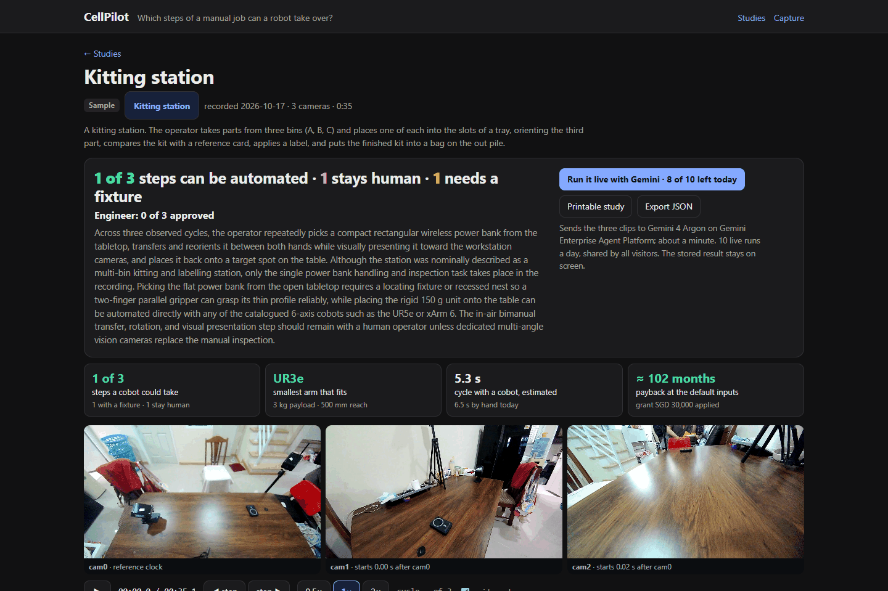
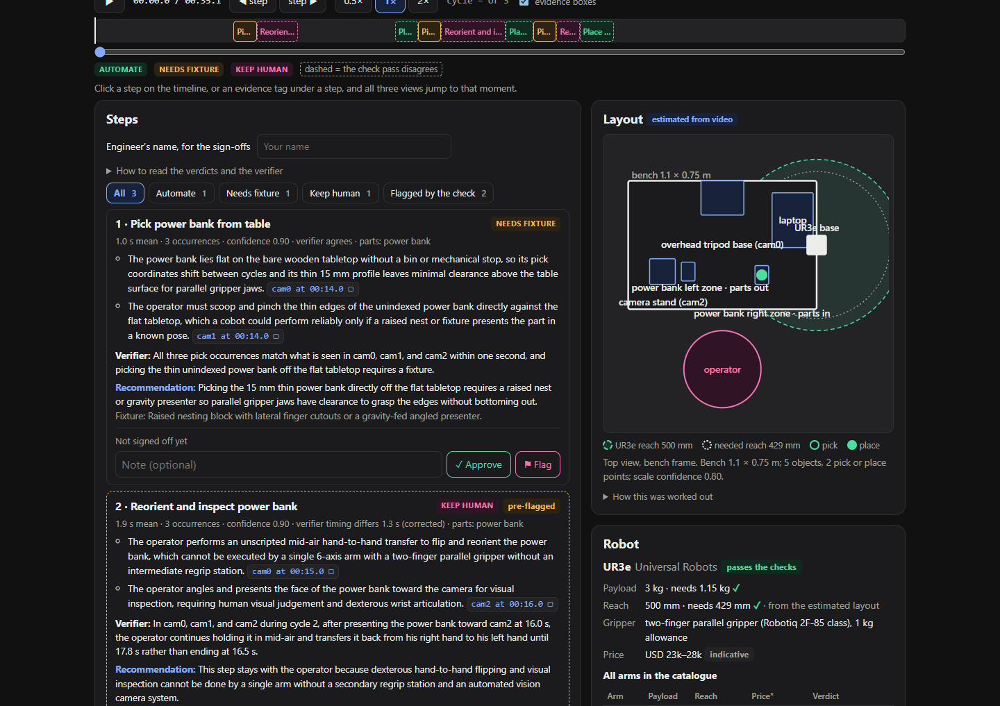

# CellPilot

Which steps of a manual job could a cobot take over? Film a workstation with three time-aligned cameras, and CellPilot returns a feasibility study for an engineer to review: the steps with timings, a verdict on each step with evidence drawn on the footage, a self-check across the three views, a top-view layout of the station, a cobot checked by payload and reach against a six-arm catalogue, a cycle-time and payback estimate, and a printable study. The engineer approves or flags every step.

Built by team NODAL for the AI Builder Cup 2026, Manufacturing track. All code here was written during the hackathon.
**Live:** https://cellpilot-462384168489.asia-southeast1.run.app (Cloud Run, Singapore). Open the sample study; no sign-in needed. "Run it live with Gemini" re-analyses it; live runs are capped at 10 a day for all visitors, and the button shows how many are left.



*The sample study on real footage: a kitting-station take recorded on 17 October 2026 with three NODAL M1 cameras, analysed by Gemini 4 Argon in one live run. Below the views: the timeline, each step with its evidence, the verifier's check and the engineer's sign-off, the layout estimated from the video, and the robot check.*



## How it works

1. **Input:** three MP4 clips (`cam0`, `cam1`, `cam2`) and a `session.json` with each camera's time offset. Our reference rig is [NODAL M1](https://www.nodal3d.com/) (three global-shutter cameras started by one RF trigger, so the offsets come straight from the sync sidecars); any calibrated, time-aligned cameras work. The page's **Capture guide** (`#/guide`) shows where the cameras go, how the clips are aligned, what good footage looks like and how a session folder is made.
2. **Gemini 4 Argon on Gemini Enterprise Agent Platform** (formerly Vertex AI), three passes, each held to a JSON schema, all sharing the same clips-and-context prefix so implicit caching applies:
   - pass A sees all three clips in one request and returns the steps, their timings on one shared clock, a verdict per step (automate, keep human, or needs a fixture) with two reasons that each cite a camera, a time and a box on that frame;
   - pass D (the verifier) sees the same clips and pass A's answer, corrects timings that are off by more than one second, and flags any verdict it disagrees with. It never changes a verdict;
   - pass C (the layout) estimates a top view in metres: bench size, bins, fixtures and tools, and where each step picks and places. It is optional: if it fails the study ships without a layout and says why.
3. **Our code** places the robot base and computes the needed reach from the layout, checks every arm in the catalogue by payload and reach and picks the smallest one that passes, estimates the robot's cycle from the step durations and a conservative speed factor, computes the payback (every input editable on the page), and records the engineer's sign-offs. Argon's raw answers are stored word for word, and each result names the model that produced it.
4. **A second Gemini model writes the engineer's notes** (`gemini-3.8-flash` by default, text only, no video): from the steps, verdicts, robot check and payback it writes a plain summary for the owner, a recommendation per step (the gripper, the fixture, or why a step stays manual), the top risks, next steps and the questions to answer before committing. It never changes a verdict, and the page says the notes were written from the analysis, not from the video. If this pass fails the study ships without notes and says why.

The bundled sample study, `samples/kitting-20261017`, is a real recording: a 35 s kitting-station take (three cycles) filmed on 17 October 2026 with three NODAL M1 cameras at 1080p30, started together on one RF trigger. Their first frames came 1.9, 3.8 and 18.6 ms after the trigger (`sources.json`), so the three views are within one frame of each other. `session.json` carries the offsets, `analyses/` the stored result of one run (Gemini 4 Argon for the steps, the verifier and the layout; `gemini-3.8-flash` for the engineer's notes) and `argon/` the raw model answers word for word. The clips in the repository are re-encoded from the converter's 720p output with a 4 Mbit/s cap to keep the repository small; the analysis ran on the converter's crf-20 encodes, which have the same frames and timing.

## What the page shows

- **Sessions:** what a session is, the three-step flow, and how to bring your own footage.
- **Analysis:** the "N of M steps can be automated" banner; the three views in sync with the evidence boxes drawn over them; the timeline; each step with its verdicts, reasons (click to seek and see the box), verifier note and sign-off; the **Layout** sketch (bench, objects, pick-to-place arrows, the proposed base, the chosen arm's reach circle and the needed reach); the **Robot** card with every catalogue arm judged; the **Cycle time** card (where the cycle goes by step, and the robot estimate with an editable speed factor); **Payback**.
- **Printable study** (`#/s/<sid>/report`): one document with everything above and the sign-offs, for print or PDF. **Export JSON** gives the raw result and sign-offs.
- **Capture studio** (`#/capture`): with the local bridge running next to the rig, the cameras, previews, the one-button take, the sync check and "Make session"; on the cloud link, the capture guide with a note that the studio runs on the rig PC.

Every estimate says so on screen: the layout is "estimated from video", the robot cycle is an "estimate", price bands are "indicative".

## Run it locally

```powershell
python -m venv .venv
.venv\Scripts\pip install -r requirements.txt -r requirements-dev.txt
.venv\Scripts\python -m pytest            # no network: Argon is stubbed, the cameras are faked
node --test web\logic.test.mjs            # the page's pure logic
.venv\Scripts\python -m app.main          # http://localhost:8080, store in .\data
.venv\Scripts\python -m capture.bridge    # the capture studio's local bridge, http://127.0.0.1:8095 (see below)
```

Viewing the stored sample needs no credentials. A live run needs Gemini Enterprise Agent Platform access through Application Default Credentials (`gcloud auth application-default login`) and `GOOGLE_CLOUD_PROJECT`. Settings: `CELLPILOT_MODEL` (default `gemini-4-argon`), `CELLPILOT_NOTES_MODEL` (default `gemini-3.8-flash`), `CELLPILOT_VIDEO_FPS` (default 1), `CELLPILOT_DAILY_LIVE_RUNS` (default 10), `CELLPILOT_MAX_RUNNING` (default 1), `CELLPILOT_STORE` (a folder, or `gs://bucket` in production). `web/dev/mock_server.py` serves the page with hand-written fixture data for front-end work.

To regenerate a sample's stored analysis (three paid Argon calls and one notes call): `python -m app.pipeline <sid> --save-sample`.

## Capture studio

The capture half of the product, on the PC next to the rig: cameras online → previews → one-button take → sync check → session → analysis. It is the page's `#/capture` route plus a small local bridge, `capture/`, that speaks the NODAL M1 cameras' WebSocket protocol (JSON envelopes, binary preview frames) and the rig controller's `cmd.fire`. The controller owns the RF trigger dongle; the bridge never touches a serial port. Endpoints are in `docs/contract.md` ("Capture bridge").

```powershell
copy capture\config.example.json capture.json      # camera ids and ws:// addresses, controller, folders
.venv\Scripts\python -m capture.bridge             # 127.0.0.1:8095, localhost only
.venv\Scripts\python -m app.main                   # the page; open http://localhost:8080/#/capture
```

`capture.json`: `cameras` (`id`, `url`, e.g. `ws://192.168.1.42:5100`), `controller.url` (the rig controller that fans out `cmd.fire`; the emulator's is `ws://127.0.0.1:5000`), `offload_dir` (where a take's clips and sidecars land on this PC), `samples_dir` (where "Make session" writes; `samples/` so the session ships with the app), `preset`. **`allow_lan` is false by default and the bridge refuses any address that is not localhost**; set it to true only for the real rig, with someone at the cameras.

**Which rig the studio talks to** is whatever the bridge config names, and the studio's first card says which: the emulator (`m1sim rig --cameras 3` from the NODAL M1 emulator; its controller listens on 5000 and the cameras on 5101 to 5103, which is what `config.example.json` expects) or the live rig (a config with the cameras' LAN addresses and `allow_lan: true`). To switch, stop the bridge and start it on the other file: `python -m capture.bridge --config <file>`, then reload the page. The sample study needs no rig at all.

**A take has a length, not a pause.** Record starts a take of the seconds given; every camera records from its first frame after the trigger and stops by itself; Stop ends it early. Each camera writes one clip per take, so to pause you stop and record another. Record is disabled while the rig controller is offline, because only the controller can send the RF trigger; a take recorded with NODAL Capture instead goes through “Check a folder” and “Make session”.

What the page does with a bridge running: camera cards (state, preset, battery bars, clock, live preview), a placement checklist, **Record a take** (name, seconds: the controller disarms and arms every camera, sends the RF trigger, each camera records from its first frame after the trigger and stops by itself), live state armed → recording → stopped → offloaded, the **offset check** (each camera's first frame delay after the trigger from its sidecar, the resulting offsets, the spread against one frame), and **Make session** (re-encode to 720p, write `session.json` with the offsets) with a link to the analysis. Without a bridge (the cloud link) the route shows the capture guide under a note saying so. A take recorded with NODAL Capture instead can be checked and converted from its offload folder on the same page, or from the command line:

```powershell
.venv\Scripts\python -m capture.convert <offload folder> samples\kitting-01 --id kitting-01 --name "Kitting station, 9 cycles" [--clip take_001] [--ref rx-cam1]
```

**The cloud demo carries the studio too.** With `CELLPILOT_CAPTURE_CONFIG=capture/config.cloud.json` the service mounts the bridge at `/capture-bridge` and the page uses it: the rig is a simulated M1 rig on NODAL's emulator console (three virtual cameras speaking the real camera protocol, the real controller, synthetic footage), reached over HTTPS with a login from `M1SIM_USER` and `M1SIM_PASSWORD`. The console exposes only the controller, so the bridge takes the cameras' heartbeats, previews and recording events from the controller's relay and, after a take, downloads the session zip (clips, sidecars, ground truth) into the offload folder; the offset check and "Make session" then run as on a PC. Takes are capped at 60 s there, and a bridge that started the rig itself fires a 3 s warm-up take first, because a freshly started emulator rig has missed a camera on its very first clip. The emulator itself is NODAL's existing tool and is not part of this submission. Deploy with `.\deploy.ps1 ... -CaptureConfig capture/config.cloud.json -EnvFile <file with the two variables> -Cpu 2 -Memory 2Gi`.

The whole flow is tested against the NODAL M1 emulator (three simulated cameras and the real controller on localhost): `tests/test_e2e_emulator.py`, run with `CELLPILOT_E2E_CONFIG` pointing at a bridge config for the running rig. The unit tests fake the cameras and the controller over real WebSockets.

## Deploy

One Cloud Run service: `deploy.ps1` builds from source and deploys with `--no-cpu-throttling --max-instances 1`, because each analysis runs in a background thread of the single instance. Results and sign-offs go to Cloud Storage. Clips over 15 MB in total must be served from the bucket (`CELLPILOT_STORE=gs://...`).

## The robot catalogue

Six cobots with the vendors' published payload and reach (links in `app/catalogue.py`): UR3e (3 kg, 500 mm), UFACTORY xArm 6 (5 kg, 700 mm), UR5e (5 kg, 850 mm), Franka FR3 (3 kg, 855 mm), Doosan M0609 (6 kg, 900 mm), UR10e (12.5 kg, 1300 mm). Needed payload = the heaviest part of the automatable steps + 1 kg for a two-finger gripper. Needed reach = the farthest pick or place of the automate and needs-fixture steps from the proposed base ÷ 0.85. The smallest arm that passes both checks is chosen; with no layout the reach is not checked and arms under 700 mm are not proposed. Price bands are rough list-price bands from public reseller listings, labelled indicative, never quotes.

## Honest limits

- The sample is analysed from stored results; "Run it live" re-analyses it with Argon, capped per day and shared by all visitors.
- The layout is the model's estimate from the footage, not a measurement; a measured layout from a calibration board seen by all three cameras is the next step. The robot cycle is step durations × a conservative factor, not a simulation.
- Argon's timings are only as precise as the frame sampling rate (0.5 s at 1 fps on our tests, 0.1 s at 5 fps); evidence boxes are the model's, on a 0–1000 grid.
- **No browser upload in this build.** A session is added by its folder on the server. The design, if it is added: `POST /api/sessions` (name, offsets), then one `PUT /api/sessions/{sid}/clips/{view}` per clip (Cloud Run caps a request at 32 MiB, so the three clips cannot share one request), stored in the bucket and served through `/media`; the analysis of an uploaded session counts against the same daily live-run cap. It was left out because clips of an unrelated scene would only produce an unusable study, and the time went to the layout, the robot check and the printable study instead.

## Licence

Apache-2.0 (see `LICENSE`). Third-party components are listed in `THIRD_PARTY_LICENSES.md`.
